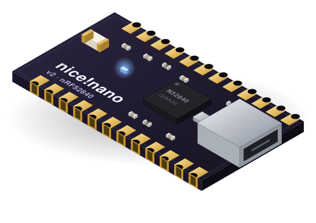

# lightbar-homekit

[](https://github.com/sverdejot/lightbar-homekit/actions/workflows/build.yml)

<p align="center"></p>

Control a **Xiaomi Mi Computer Monitor Light Bar (MJGJD01YL)** from Apple Home
and Siri with a single **nice!nano v2**. The board joins your home as a
Matter-over-Thread dimmable light and speaks the bar's 2.4 GHz protocol with
the same radio. No extra modules.

## What you need

- nice!nano v2 (or any nRF52840 board with the Adafruit UF2 bootloader)
- A Thread border router: HomePod mini, HomePod (2nd gen) or Apple TV 4K
- Xiaomi light bar **MJGJD01YL**, the version with the wireless knob
- macOS with [mise](https://mise.jdx.dev)

```sh
mise install && mise run setup:python
```

Double-tap RST↔GND to enter the bootloader: the board shows up as a
`NICENANO` drive.

## 1. Get the remote id

The bar only obeys its paired remote's 3-byte id. In the bootloader, load the
sniffer (`sniffer.uf2` from a release), start sniffing and turn the knob:

```sh
mise run uf2:copy sniffer.uf2
mise run sniffer:sniff
```

```
learned remote id 50F160 (saved)
```

Your id is `0x50F160`.

## 2. Flash

**Prebuilt:** fork this repo, run **Actions → Release** with your id, and
download the release. Then, in the bootloader:

```sh
mise run uf2:copy dfu_stub.uf2
mise run flash --pkg lightbar-matter-0x50F160.zip
```

**From source** (needs [`nrfutil`](https://www.nordicsemi.com/Products/Development-tools/nRF-Util);
`setup` downloads the nRF Connect SDK, several GB):

```sh
mise run setup
mise run flash --remote-id 0x50F160
```

## 3. Add to Apple Home

Home app → **Add Accessory → More options**, setup code **`3497-011-2332`**.
Accept the uncertified accessory warning and put it in a room. The blue LED
blinks until the board joins Thread and stays on afterwards.

*"Hey Siri, turn on the living room lights."*

## Good to know

- The bar only has a toggle, so if you use the original remote Home may show
  the wrong state. Toggle twice from Home, or `lamp state on|off` from
  `mise run console`.
- The sniffer firmware erases the Home pairing; get the id before adding the
  board to Home.
- Protocol details: [`docs/protocol.md`](docs/protocol.md).

## Credits

Protocol by [lamperez/xiaomi-lightbar-nrf24](https://github.com/lamperez/xiaomi-lightbar-nrf24)
and [ebinf/lightbar2mqtt](https://github.com/ebinf/lightbar2mqtt). Firmware
based on the nRF Connect SDK Matter light bulb sample.

MIT, see [LICENSE](LICENSE). Files from the nRF Connect SDK samples keep their
`LicenseRef-Nordic-5-Clause` license.
